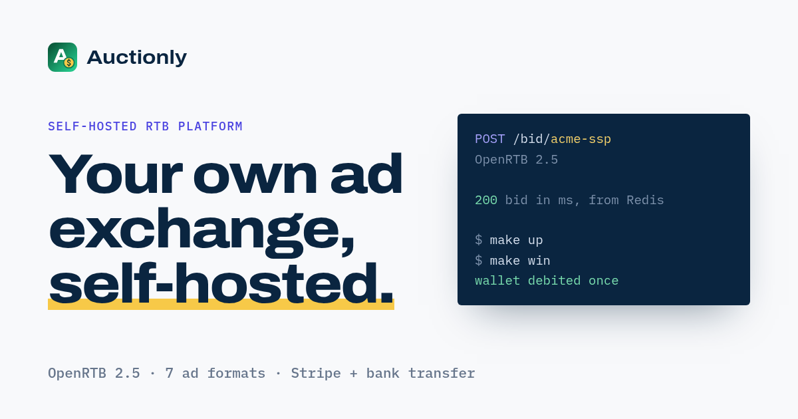
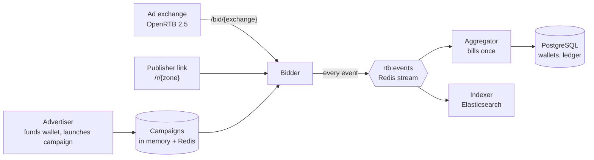
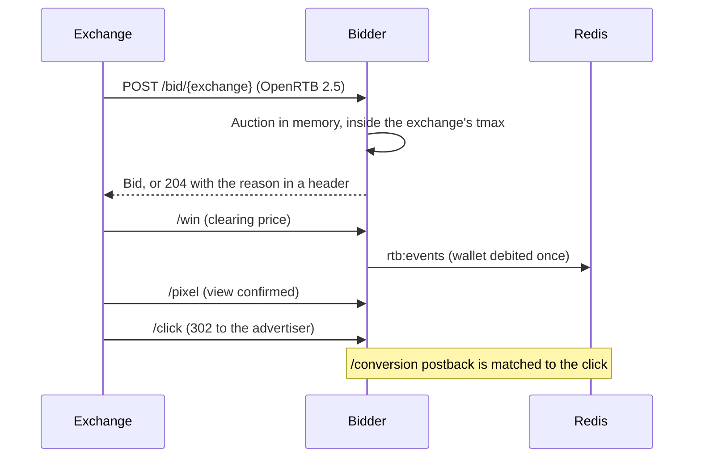
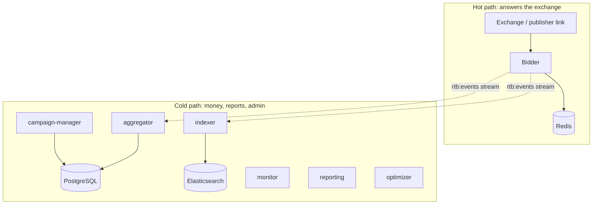

<div align="center">


# Auctionly

### The self-hosted campaign manager for push, pop, domain redirect and deeplink traffic.

Advertisers, publishers and exchanges on **your own server**. A bidder that answers in under 100 ms, a publisher portal with tracked links, and billing that charges every visit exactly once.


[How it works](#how-it-works) ·
[Features](#what-you-get) ·
[Architecture](#architecture) ·
[API](#rest-api) ·
[Deploy](#deploy) ·
[Pricing](#get-auctionly) ·
[FAQ](#faq)



</div>

---

## Why Auctionly

Running a traffic network usually means renting someone else's platform, paying a percentage of every click, and hoping your data stays yours. Auctionly turns that around.

| | |
|---|---|
| **You own the data** | Campaigns, wallets, events and creatives live in your PostgreSQL, Redis and Elasticsearch. There is no Auctionly cloud. |
| **Two ways to get supply** | Buy from ad exchanges over OpenRTB 2.5, or onboard publishers who send visitors through a tracked link. Same wallet, same reports. |
| **Money is exact** | A visit, click or conversion delivered twice is charged once. Wallets reconcile against a ledger, and there is a command to prove it. |
| **Built to stay fast** | The bid path never opens a database connection. A slow Postgres cannot slow a bid. |
| **Looks after itself** | Campaign review, traffic-quality limits, a monitor with alerts, automated backups, and tested restores. |

> **No banners, no video, no ad sizes.** Auctionly sells **traffic**. That keeps the product small, the rules clear and the billing simple.

## How it works



There are three kinds of traffic, and each one ends in the same event stream, so billing and reporting always read the same facts the bidder produced.

### 1. Exchange traffic (OpenRTB)

An exchange is registered once and posts to its own `/bid/{exchange}` endpoint. Every hop after the bid is HMAC-signed.



### 2. Publisher traffic (no ad tag, no auction)

Most publishers cannot speak OpenRTB, so they do not have to. They sign up, verify a site and copy a link:

```text
GET /r/z-4f2a91c07b
    ?adv=5&floor=0.005&sig=<hmac>
    &sub=push_us_1&clickid=a81f2c…&keyword=intel_i5
    &product_url=https%3A%2F%2Fbrand.com%2Fp%2F1
```

The advertiser, bid floor and fallback are signed by the platform. The **sub ID, click ID and keyword are the publisher's own** and are stored with every click. Matching campaigns take turns at their fixed prices, the visit counts as the view and the click, and the visitor is redirected with a click id. If no campaign takes the visit, the link's fallback URL is used.

### 3. Conversions

```text
GET /conversion?click_id=35f1668d…&event=purchase&value=25&tx=order-1
→ { "status": "recorded" }
```

The platform hands its click id to the advertiser's network in the destination URL. When a visitor buys, the network calls `/conversion` with that id. The conversion is matched to the click inside its window, counted, and the publisher's own click id goes back to their tracker in a postback. A pixel and an API call work too, for advertisers without a network.

## What you get

### Four ad formats, one campaign form

| Format | `adformat` | What the campaign takes |
|---|---|---|
| **Push** | `push` | Notification title, body, icon and a destination URL. Sent to exchanges as an OpenRTB native ad. |
| **Pop** | `pop` | A destination URL. No creative to host. |
| **Domain redirect** | `domain` | A destination URL for redirect traffic, such as parked and type-in domains. |
| **Deeplink** | `deeplink` | A network or tracker deeplink with `{product_url}` where the product page goes. |

Through exchanges all four run. Publishers you onboard directly sell pop, domain redirect and deeplink. Push stays on OpenRTB. The web form and the REST API share one rule set, so neither can save a campaign the other would refuse.

<details>
<summary><b>How deeplinks work</b></summary>

<br>

The advertiser takes the deeplink from their affiliate network and replaces the landing-page parameter with `{product_url}`:

```text
https://network.example/deeplink?offer=12&url={product_url}&cid={click_id}&camp={campaign_id}
```

The visit brings the product page. Auctionly URL-encodes it into the tag and redirects to the network, which forwards the visitor.

- Only product pages on the **brand's own site** are sold, so a publisher cannot send traffic anywhere else through a deeplink.
- A destination where the tag would replace part of the address is refused when the campaign is saved.
- The form links to a guide with the landing-page parameter of each network.

</details>

### For advertisers

- **Self-serve buying.** Sign up, fund a wallet, create a campaign.
- **Targeting.** Geo (country to ZIP), device, OS, carrier, domain, app, zone, sub ID, category, keyword and audience.
- **Bid hierarchy, most specific wins.** Zone, then site / app / publisher, then category, then exchange, then the campaign default. Pay more on the zone that converts and the default everywhere else.
- **Controls.** Daily and lifetime budgets, pacing, frequency caps, schedules, impression and click limits. A campaign that hits one pauses and records why.
- **Conversions.** A postback builder, a window per campaign, six attribution models, and conversions that keep the click's format, zone and country. Hold them for approval, and reverse one later if it turns out to be fake.
- **Optimizer.** Give a campaign a CPA or CTR goal and a bid multiplier moves toward what converts.
- **Reports on every dimension.** Campaign, day, hour, exchange, bid level, creative, country, OS, device, site, publisher, ad format, zone and sub ID, with CSV export and event-log search.

### For publishers

- **A portal of their own.** Sites and their review status, a **Link generator**, reports by source, and a dashboard of visits, clicks, conversions and earnings.
- **Ownership is proven first.** A meta tag, a file at the site root, or a DNS TXT record. You approve the site, and only then can it make links. Suspend a site and its links stop at once.
- **Test link.** A dry run that shows where a visitor would be sent and counts nothing.
- **Reports by source.** By day, advertiser, sub ID, sub ID per site and site, plus a click-level report with every click ID.
- **Postbacks to their own tracker**, with the publisher's click ID, sub ID and payout.
- **Paid on your terms.** A share of the advertiser's spend, or a fixed amount per visit, click or conversion, set per publisher or per zone. Earnings are held for a few days, then paid out on request.
- **An API of their own.** `X-API-KEY` header, a rate limit, and endpoints for links, reports, sites, placements, sub ID lists and postbacks.

### For exchanges

- A dedicated `/bid/{exchange}` endpoint per partner. It is token-checked and can be paused.
- OpenRTB 2.5 request, impression, device, geo, deal and native objects.
- Deals as a targeting dimension on each campaign.
- Traffic-type classification for pop, push and redirect supply that OpenRTB cannot describe.
- A win-price macro and signed win, pixel and click URLs per exchange.
- Plain no-bids: a `204` with the reason in a header, so partners can debug.

### For you, the operator

- **Every campaign is reviewed before it bids.** Approve it, or send it back with a note. Trusted advertisers can skip the queue, and one setting turns review off.
- **Audit log** for sign-ins, account changes and admin actions.
- **A System page** that shows event backlog, aggregator lag, lost events, errors and backups as ok, warn or critical, with a webhook when the state changes.
- **A margin view** of what advertisers paid against what publishers earned.

## Billing

Advertisers fund a **prepaid wallet**. Spend is debited as visits, clicks and conversions are booked, and a campaign pauses when its funds run out.

| | Card (Stripe) | Bank transfer |
|---|---|---|
| **How it works** | Hosted Stripe checkout | Advertiser requests a top-up and sees your bank details |
| **Credited when** | A **signed webhook** confirms. Never because a browser said so. | You enter the amount received and the bank reference and approve |
| **If something is lost** | A worker asks Stripe about pending payments every minute | Requests nobody approves expire on their own |
| **Refunds** | A refund in Stripe debits the wallet | n/a |

- No Stripe SDK. Auctionly calls Stripe's HTTP API directly, so there is less code to audit.
- Defaults: minimum top-up **$10**, maximum **$10,000**, first top-up capped at **$500** until a first payment settles (this limits the damage from a stolen card). All are configurable.
- Leave your bank details empty and the option disappears. Run card-only or transfer-only.
- Every credited top-up has a printable receipt with your company details.

## Architecture

The path that answers an exchange is kept small and separate from everything that can be slow.



| Service | Responsibility |
|---|---|
| `campaign-manager` | Web app and REST API: campaign form, wallets, users, admin |
| `bidder` | OpenRTB endpoint and publisher links. Reads campaigns from memory and Redis only |
| `aggregator` | Books spend and stats from the event stream. Exactly one runs, enforced by a lock |
| `indexer` | Writes each event to Elasticsearch for search and reports |
| `reporting` | Totals, time series and breakdowns |
| `optimizer` | Moves bid multipliers toward your CPA or CTR goal |
| `monitor` | Checks backlog, lag, lost events, errors and backups, and raises alerts |

### Engineering guarantees

- **Redis only on the bid path.** The bidder has no database driver in its request loop.
- **Exactly-once billing.** The aggregator books each batch and its stream position in **one transaction**, so a crash or a redelivery cannot bill twice.
- **Bad events cannot stall billing.** An event that fails three times is moved to a quarantine list, the rest of the stream keeps flowing, and you are alerted.
- **Redis can be rebuilt.** The campaign snapshot and today's spend counters are rebuilt from PostgreSQL. Only events not yet read by the aggregator live in Redis alone, and the monitor watches how old they are.
- **Fails in the exchange's favour.** If Redis is down, win notices answer `503` so the exchange retries instead of losing the sale.
- **Under 100 ms target.** A per-request deadline is derived from the exchange's `tmax`.
- **Fuzz-tested input.** Seeded, malformed bid requests must never crash the parser or the auction.
- **Chaos-tested outages.** Redis, Postgres, Elasticsearch, mail and a killed worker are injected on purpose.
- **Publishers do not slow the bidder.** Zones live in their own Redis hash and are fetched on demand, so a new zone never makes every bidder reload the campaigns.
- **Images stay off the app server.** Push icons are served from a media domain straight from disk with immutable caching. Point a CDN at it when traffic grows.
- **Ledger in whole micro-dollars.** `make reconcile-ledger` proves every wallet equals its ledger.

```bash
make stan     # PHPStan level 8, every service
make fuzz     # malformed bid requests
make chaos    # kill Redis, Postgres, Elasticsearch
make latency  # measure bid latency with wrk on your hardware
```

## Traffic quality and security

Exchanges are contracted companies. Publishers are anyone who signs up. So Auctionly assumes **any number a publisher produces could be false**, and bounds what it can cost you.

| Control | What it does |
|---|---|
| **Verified sites only** | A link works only while its site is approved. Suspending a site stops its zones at once. |
| **Signed links** | The advertiser, bid floor and fallback carry an HMAC. A changed or forged link is refused. |
| **Real visitors** | Bots, crawlers and scripts are not sold. Country and device come from your edge network, not from the publisher. |
| **Visit limits** | A visitor is sold a few times a day through one zone. Addresses and zones have per-minute and per-day ceilings. |
| **Labels stay labels** | Sub ID, click ID and keyword never decide who the publisher is, what it is paid or what a campaign sees. |
| **OpenRTB off by default** | A publisher's own bid requests prove nothing, so the endpoint is opt-in per zone. |
| **Payout hold** | Earnings are held for a few days so bad traffic can be taken back with an adjustment. |
| **Quality flags** | Zones with a very high click rate, no conversions, or a payout above what advertisers pay are flagged for review. |
| **Two-factor, enforced** | Admins must enable TOTP. Recovery codes and a 48-hour cancellable lost-phone flow. |
| **Signed tracking URLs** | Win, pixel and click URLs carry an HMAC and cannot be forged. |
| **Signed postbacks** | An advertiser can require an HMAC on conversion postbacks. A click can credit at most five conversions. |
| **Privacy signals** | The bidder reads TCF v2, GPP and US privacy strings and does not bid where consent was not given. |
| **Backups you have restored** | `make backup` and `make restore-drill`, which restores into a scratch database and checks it. |

> **Honest limits.** A redirect has no page to inspect, and a script can fake a referrer. The limits, the hold and the flags **bound the cost**. They are not a promise that no fake traffic exists. You stay responsible for your own legal review.

## REST API

Everything in the web app is in the API too: ten endpoints under `/api/v1`, JSON in and out, and one personal token per script. A token only ever sees its own owner's data, and the same validation applies as in the form.

| Method | Endpoint | |
|---|---|---|
| `GET` | `/api/v1/me` | Who the token belongs to |
| `GET` | `/api/v1/advertisers` | The accounts you can see, with wallet balance |
| `GET` | `/api/v1/campaigns` | List with filters, paging and sorting |
| `POST` | `/api/v1/campaigns` | Create. The body is the campaign form |
| `GET` `PUT` `DELETE` | `/api/v1/campaigns/{id}` | Read, change or delete one campaign |
| `POST` | `/api/v1/campaigns/{id}/status` | Activate, pause, draft or archive |
| `POST` | `/api/v1/media` | Upload a push icon or image and get its address |
| `GET` | `/api/v1/reports/campaigns` | Spend, clicks and conversions per campaign |

```bash
# upload an icon
curl -X POST $BASE/api/v1/media \
  -H "Authorization: Bearer $TOKEN" \
  -F image=@push-icon.png
# { "data": { "url": "https://media.example.com/media/ab/3f…c1.png", "width": 192, "height": 192 } }

# go live (answers 202 while the campaign waits for review)
curl -X POST $BASE/api/v1/campaigns/123/status \
  -H "Authorization: Bearer $TOKEN" \
  -d '{"status":"active"}'
# HTTP 202  { "data": { "id": 123, "status": "pending_review" } }
```

## Deploy

Every service is its own container. Start on a laptop, then move the same images to a server.

```bash
cp .env.example .env
make install
make up
make migrate
make seed
# campaign manager on :9502, bidder on :9501
```

`make seed` creates an admin, advertisers, campaigns, publishers with links and 30 days of traffic. `make traffic` sends 300 requests through bid, win, pixel, click and conversion. For a local test with many clicks, set `APP_ENV=local` and run `make fresh`.

Try a bid:

```bash
curl -X POST localhost:9501/bid/demo \
  -H 'Content-Type: application/json' \
  -d @services/bidder/fixtures/sample-bid-request.json

make win   # bid, win notice (sent twice), pixel, click: wallet debited once
```

**Production** puts Caddy in front (automatic HTTPS, HTTP/2, request size limits). Caddy is the only published service. Postgres, Redis, Elasticsearch, reporting, aggregator, indexer and monitor stay on a private network. The written guide takes a fresh Linux server to HTTPS in about 45 minutes, plus DNS.

```text
internet → caddy :80 :443
            ├─ campaign-manager
            └─ bidder
private network only:
            postgres · redis · elasticsearch · reporting · aggregator · indexer · monitor
```

**A go-live check refuses to pass while something is unsafe:** a weak secret, debug on, email going nowhere, Stripe in test mode, `APP_ENV` not `production`, or missing company details.

```text
./scripts/prod-check.sh
  ok    DB_PASSWORD looks strong
  ok    administrators must use two-factor
  ok    Stripe is in LIVE mode
  FAIL  LEGAL_REVIEWED is not true
  FAIL  COMPANY_ADDRESS is empty
NOT READY: 2 blocking problem(s)
```

## Get Auctionly

Auctionly is **commercial, source-available software**. You receive the code and deploy it yourself. Choose how much help you want with it.

| | **Source licence** | **Subscription** | **White-label** |
|---|---|---|---|
| **Price** | **$999** one-time | **$1,499** | Agreed together |
| **Full source for all services** | ✅ | ✅ | ✅ |
| **One payment, no renewal** | ✅ | | |
| **Continuous updates** | | ✅ | ✅ |
| **Support channel** | | ✅ | ✅ |
| **Consultation** | | | ✅ |
| **Your brand on the whole platform** | | | ✅ |

Prices are in US dollars. **Talk to us:** [contact@auctionly.cc](mailto:contact@auctionly.cc?subject=Auctionly) to ask for the source, a live demo, or a white-label plan.

<!-- Add here once published: [Live demo](URL) · [Documentation](URL) · [Website](URL) -->

## FAQ

<details>
<summary><b>Is Auctionly a hosted service?</b></summary>

No. It is self-hosted software. You deploy it with Docker on your own server, and your campaigns, wallets and events stay on your infrastructure.
</details>

<details>
<summary><b>Which OpenRTB version does it support?</b></summary>

OpenRTB 2.5. Each exchange gets its own `/bid/{exchange}` endpoint and receives a bid, win notices and tracked clicks.
</details>

<details>
<summary><b>How fast is the bidder?</b></summary>

The target is under 100 ms. The bidder never touches the database on the bid path, and it applies a deadline derived from the exchange's `tmax`. `make latency` measures it with wrk on your hardware.
</details>

<details>
<summary><b>Can publishers send traffic without an ad server?</b></summary>

Yes. A publisher signs up, adds a website, verifies it and makes a link in the Link generator. There is no ad tag, no OpenRTB and no auction on that path: matching campaigns take turns at fixed prices.
</details>

<details>
<summary><b>Can a click be billed twice?</b></summary>

No. A visit, click or conversion delivered twice is charged once. Events are keyed by their stream id, so a redelivered event overwrites itself instead of billing again.
</details>

<details>
<summary><b>How do advertisers pay?</b></summary>

They fund a prepaid wallet by card through Stripe, or by bank transfer. Cards are credited only after Stripe confirms. Bank transfers are credited when an administrator approves the request.
</details>

<details>
<summary><b>What happens if Elasticsearch goes down?</b></summary>

Reporting falls back to PostgreSQL rollups. Dimensions that only the event log knows are reported as unavailable. Bidding is not affected, because the bidder only uses Redis.
</details>

<details>
<summary><b>Does it respect user consent signals?</b></summary>

The bidder parses TCF v2, GPP and US privacy strings. By default it does not bid on a request that says consent was not given for the purposes you list. You can switch it off or change the purposes in the environment, and you stay responsible for your own legal review.
</details>

<details>
<summary><b>Are campaigns reviewed before they go live?</b></summary>

Yes, by default. An advertiser's campaign waits in review until an administrator approves it or sends it back with a note, and the advertiser is emailed either way. Trusted advertisers can skip the review, and `REQUIRE_CAMPAIGN_REVIEW=false` turns it off for everyone.
</details>

<details>
<summary><b>Do push images need a CDN?</b></summary>

Not at first. The web app serves uploaded icons and images by default. When traffic grows, serve them from a separate media domain, cached for a year, with a CDN in front.
</details>

---

### Deploy the website

```bash
make init     # create .env.production from the example, then fill in the secrets
make deploy   # build, start, migrate and optimize
make logs     # follow application logs
```

Set `SERVER_NAME` and `ACME_EMAIL` in `.env.production` for HTTPS, and `CONTACT_TO_ADDRESS` for where inquiries go.

---

<div align="center">

**Own your traffic stack.**

[Request the source](mailto:contact@auctionly.cc?subject=Auctionly%20source%20licence) · [Ask for a demo](mailto:contact@auctionly.cc?subject=Auctionly%20live%20demo)

<sub>Self-hosted software. You deploy it, you own it.</sub>

</div>
